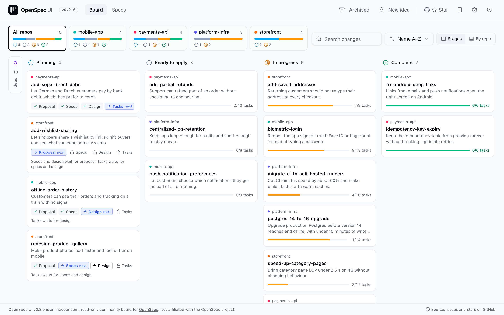
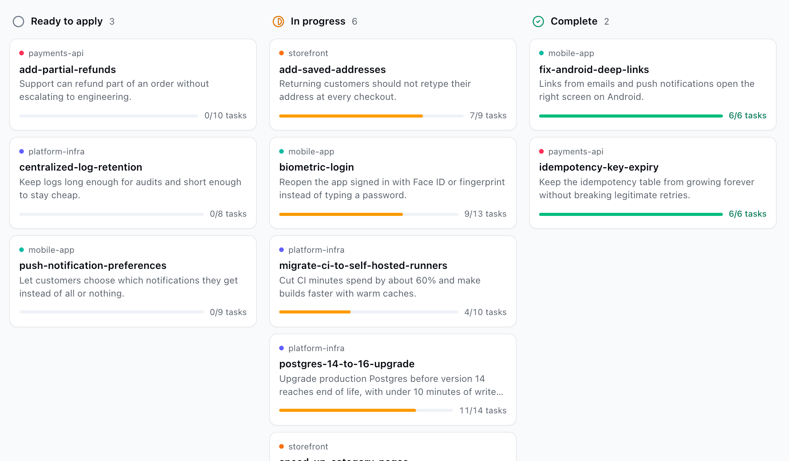
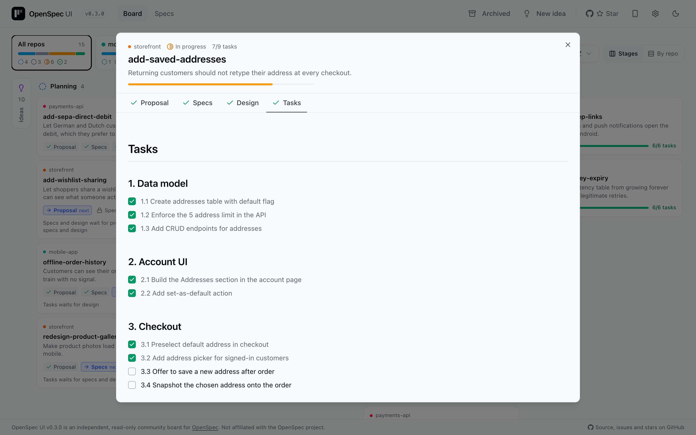
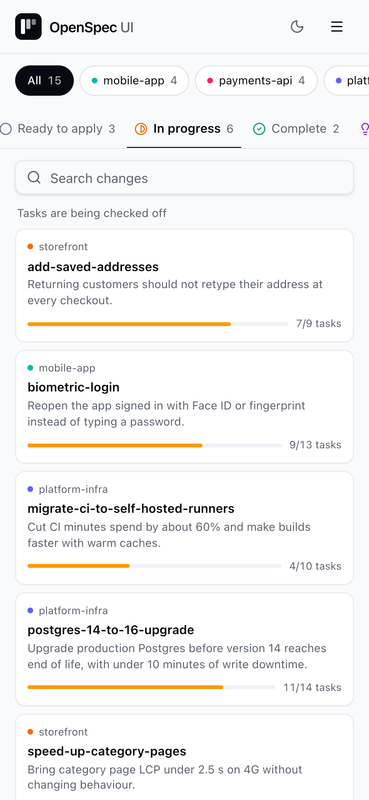

# OpenSpec UI: a web dashboard for OpenSpec

[](https://github.com/ToruAI/openspec-ui/actions/workflows/ci.yml)
[](https://github.com/ToruAI/openspec-ui/actions/workflows/conformance.yml)
[](https://github.com/ToruAI/openspec-ui/releases/latest)
[](LICENSE)

**A live kanban board for [OpenSpec](https://github.com/Fission-AI/OpenSpec) changes across all your repos.** See which changes are being planned, which are ready to apply, how far along the rest are, and which artifact to write next. A local, read-only web UI for your browser and your phone.

<picture>
  <source media="(prefers-color-scheme: dark)" srcset="docs/images/board-dark.png">
  
</picture>

```sh
npx openspec-web
```

Run it in a repo, or in a folder that holds several. It finds every `openspec/` directory, opens the board in your browser (when started from a terminal), and updates as files change. **[Try the live demo](https://toruai.github.io/openspec-ui/)** with sample data, nothing to install.

## What you see



- **Every repo on one board.** Changes sit in OpenSpec's stages: Planning, Ready to apply, In progress, Complete, plus Archived. Repo tiles count each repo's changes per stage, and one click filters the board.
- **What to write next.** While a change is still being planned, its card shows the artifact chain (proposal, specs, design, tasks, or your own schema's), marks the next one, and says what the rest wait for.
- **Live.** When your coding agent ticks a task in `tasks.md`, the card moves within a second. No refresh, no polling.
- **Read the change, not the files.** One tab per artifact, tasks as a checklist, and a Specs view for every capability.
- **Ideas rail.** Jot down an idea from the board; it is saved as a Markdown note in `openspec/ideas/` for you or your agent to turn into a change later.

`openspec view` gives you one repo's summary in the terminal. OpenSpec UI shows all your repos at once, in a browser tab or on your phone, and updates itself while your agents work.

<p>
  
  
</p>

## Install

`npx openspec-web` needs Node.js 18+ and nothing else: the package is a small launcher that downloads the binary for your platform from the GitHub release, checks its SHA-256, and caches it. Other ways to run it:

| How | Command |
|---|---|
| **npx** (macOS, Linux, Windows) | `npx openspec-web` |
| **Install script** (macOS, Linux) | see below |
| **Docker** | `docker run -p 127.0.0.1:3000:3000 -v ~/code:/repos ghcr.io/toruai/openspec-ui` |
| **Download** | [Releases](https://github.com/ToruAI/openspec-ui/releases/latest): `.zip` for macOS (Apple Silicon, Intel), Linux (x86_64, arm64, static), Windows (x86_64) |

```sh
curl -fsSL https://github.com/ToruAI/openspec-ui/releases/latest/download/install.sh | sh
```

The install script puts `openspec-ui` in `~/.local/bin` (set `OPENSPEC_UI_INSTALL_DIR` to change that), verifies it against `SHA256SUMS`, and needs no sudo; re-run it to update. The Docker image finds repos mounted under `/repos`; see [Docker notes](docs/reference.md#docker).

### Build from source

Needs Rust (stable) and Node.js 20.19+.

```sh
git clone https://github.com/ToruAI/openspec-ui && cd openspec-ui
(cd frontend && npm ci && npm run build)
(cd backend && cargo build --release)
./backend/target/release/openspec-ui ~/code
```

## Usage

```sh
openspec-ui                  # repos with openspec/ in this folder (3 levels deep)
openspec-ui ~/code           # search another folder
openspec-ui ./api ./web      # exactly these repos
openspec-ui --host 0.0.0.0   # reachable from your phone on the same network
openspec-ui --json           # one JSON line with the URL, for scripts and agents
```

It takes port 3000, or the next free one. Starting it again for the same folders reuses the running server instead of starting a second one. With `--json` it prints that one line and keeps serving, so scripts should start it in the background; `GET /api/info` returns the same JSON, and `GET /api/changes` the board's data. `openspec-ui --help` lists every option.

**On your phone.** The board listens on localhost only. Start it with `--host 0.0.0.0` and press the phone button in the header: it shows the address to open on a phone on the same network. Open it by that IP address; a name such as `my-pc.local` or a reverse proxy's needs `--allowed-host NAME`. Settings are read-only on the phone.

**A fixed list of repos.** Optional: put an `openspec-ui.json` in the folder you start from, or pass `--config`:

```json
{ "sources": [{ "name": "api", "path": "/home/you/code/api/openspec" }] }
```

With a config file, project edits in Settings are saved to it. CLI options, environment variables, the HTTP API and Docker details are in **[docs/reference.md](docs/reference.md)**.

## Use it from your coding agent

The repo ships an agent skill that starts the board (or reuses a running one) and answers status questions from its API: "what's in progress across my repos?", "which changes are ready to archive?", "what's left in add-saved-addresses?".

```sh
npx skills add ToruAI/openspec-ui      # Claude Code, Codex, Cursor, Gemini CLI, opencode, ...
```

In Claude Code you can also install it as a plugin:

```text
/plugin marketplace add ToruAI/openspec-ui
/plugin install openspec-ui@toruai
```

## OpenSpec compatibility

Tested against **OpenSpec 1.17**, and kept that way by machine, not by hand:

- `conformance/` holds ten small OpenSpec projects generated by the real OpenSpec CLI, with its recorded `openspec list --json` and `openspec status --json` answers. `cargo test` checks the board's reading of the same files against them field by field: 1028 checks covering change status, the artifact chain, `ready` / `blocked` / `skipped`, and task counts.
- The [conformance workflow](https://github.com/ToruAI/openspec-ui/actions/workflows/conformance.yml) regenerates those projects with the newest OpenSpec release every Monday and on every pull request. If an OpenSpec release changes how changes are read, the badge above turns red.

Supported: the default `spec-driven` workflow and custom schemas, `skip_specs`, changes that have a `.openspec.yaml` but no proposal yet, the pre-1.0 layout, and store checkouts (beta). The board reads files directly, so the watched repos do not need OpenSpec installed.

## What it does not do

- **It does not change your specs or changes.** No creating, editing, applying or archiving; that stays with OpenSpec and your agent. The only files it writes are idea notes in `openspec/ideas/` and `openspec-ui.json` if you use one.
- **No login.** Anyone who can reach the port can read the board and edit ideas. It listens on localhost by default; use `--host 0.0.0.0` only on networks you trust. Other websites cannot reach it through your browser, and it never reads outside the projects it shows. See [SECURITY.md](SECURITY.md).
- **OpenSpec stores are beta.** A store checkout is shown like a repo; a repo that points to a store is reported as such, and its changes are not loaded from the store.

OpenSpec UI is an independent community project. It is not affiliated with or endorsed by Fission-AI or the OpenSpec project.

## Contributing

```sh
npm ci && (cd frontend && npm ci && npm run build)
npm run dev                          # backend on the demo/ workspace + Vite dev server
cd backend && cargo test             # includes the OpenSpec conformance check
```

Every pull request adds a line under `[Unreleased]` in [CHANGELOG.md](CHANGELOG.md). Details in [CONTRIBUTING.md](CONTRIBUTING.md).

## License

[MIT](LICENSE)
